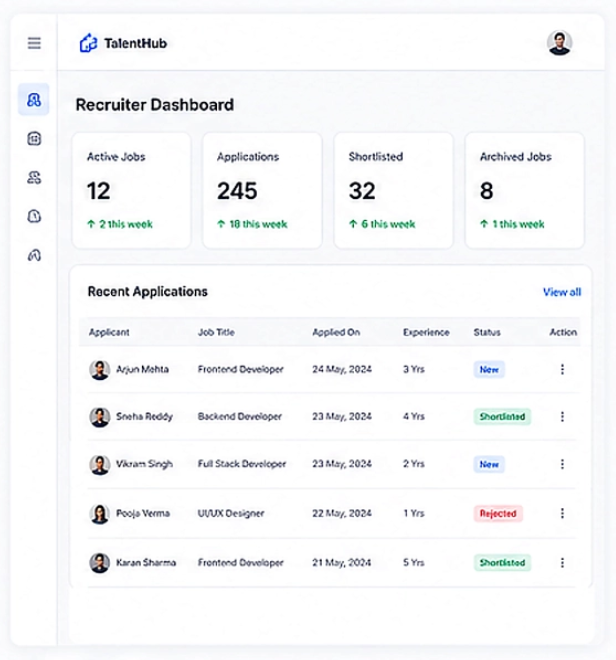
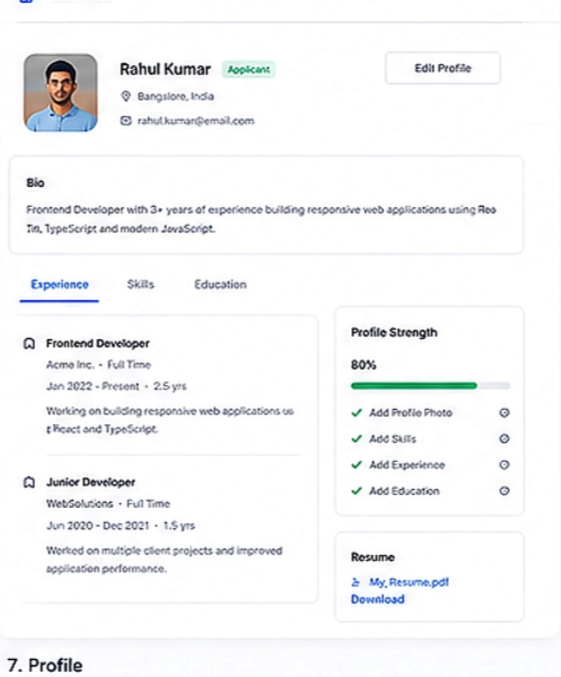

1. Make a folder for recruiter and then make folder of the component inside it.
2. In this component a dashboard  Dashboard page, Profile page and if there is any error then error page.
3. API Will integrate after that.
4. One page for the Recruiter where he can post the job details.
5. Use same registration page, after login, user should redirect to dahbaord page of the recruiter.
6. In the dashboard component. Will inetgrate the api.
7. The profile should looks like the same as applicant but it does not contains skills.
8. fullName, email, experience, location, companyName, website, about so these field should contains in the proile page. Edit details button should also in the profile.
9. One component were recruiter post the job details, edit job post details, archive job details, shortlist applications.
10. It should also contain one option that get top candidate. AI-assiatnce will display top candidate for that role .
11. Use only blue color for the buttons and text should be white if the background is blue color.
12. Profile component should looks like this in recruiter but with provided fields only.
13. Website should responsive across all devices. Don't use any emojies 
