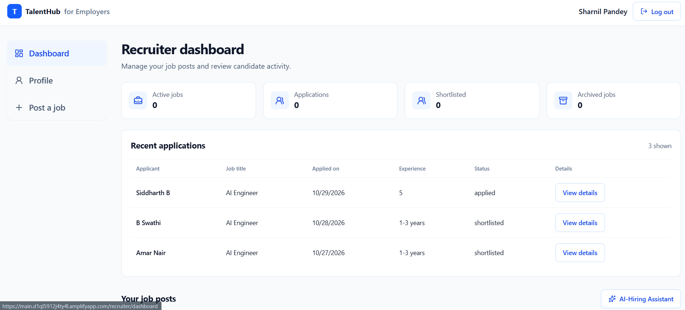
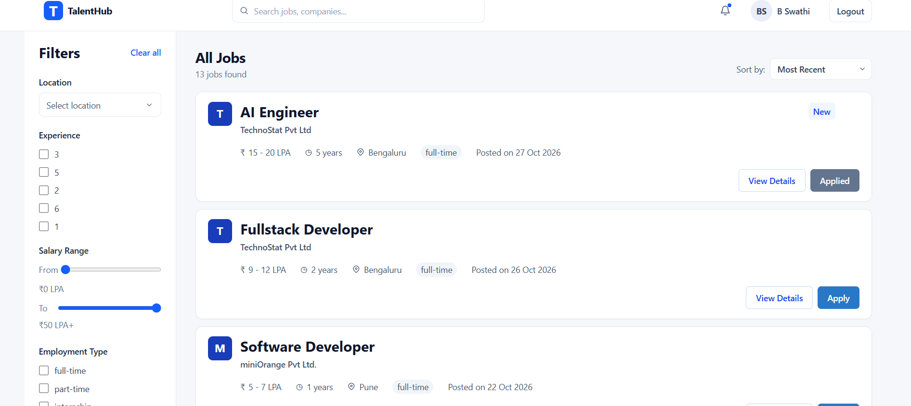
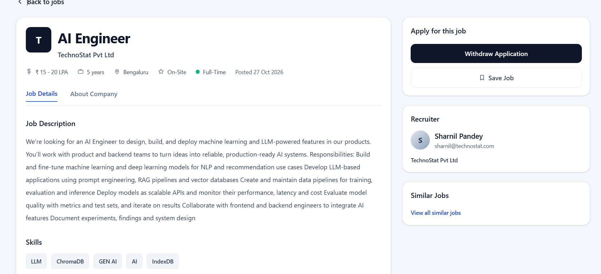

# TalentHub

A full-stack job portal where **applicants** build a profile, upload a resume, and apply to jobs, and **recruiters** review applicants and their resumes.

Built with React, Node.js, Express and MongoDB. Resumes are stored in a **private AWS S3 bucket** using presigned URLs, and the frontend is hosted on **AWS Amplify**.

> Live demo: <https://main.d1ql5912j4ty4l.amplifyapp.com/>





---

## Table of contents

- [Features](#features)
- [Tech stack](#tech-stack)
- [How resume upload works](#how-resume-upload-works)
- [Getting started](#getting-started)
- [Environment variables](#environment-variables)
- [AWS S3 setup](#aws-s3-setup)
- [API reference](#api-reference)
- [Testing](#testing)
- [Deployment](#deployment)
- [Security notes](#security-notes)
- [Roadmap](#roadmap)

---

## Features

**Applicants**
- Sign in and manage a professional profile (name, title, location, experience, skills, about, summary)
- Upload, replace and preview a resume (PDF, DOC or DOCX, up to 5 MB)
- Browse, search, filter and sort jobs (including sort by salary)
- View job details, apply, and withdraw an application
- Bookmark jobs
- Generate interview preparation for a job

**Recruiters**
- View applicants for their jobs
- Open an applicant's resume through a short-lived, permission-checked link

---

## Tech stack

| Layer | Technology |
|---|---|
| Frontend | React, Vite, React Router, Redux Toolkit, Tailwind CSS, lucide-react |
| Backend | Node.js, Express |
| Database | MongoDB (Mongoose) |
| File storage | AWS S3 (private bucket, presigned POST and GET) |
| Auth | JWT, sent as a `Bearer` token |
| Hosting | AWS Amplify (frontend) |
| Testing | Playwright (frontend end-to-end), Jest and Supertest (backend) |

---

## How resume upload works

Files never pass through the API server. The browser uploads directly to S3 using a short-lived permission slip from the backend.

```
Browser                         API server                       S3
   |  1. POST /resume/upload-url    |                              |
   |  { contentType }  -----------> |  validate type, build key,   |
   |                                |  sign policy (5 min)         |
   | <-------- { url, fields, key } |                              |
   |                                                               |
   |  2. POST multipart form (fields first, file last) ----------> |
   | <---------------------------------------------------- 204 -- |
   |                                                               |
   |  3. POST /resume/confirm { key } -->                          |
   |                                |  check key belongs to user,  |
   |                                |  HeadObject, save key in DB  |
   | <----------------------- 200 - |                              |
```

Viewing a resume works the same way in reverse. The browser asks the API for a download link, the API signs a 5-minute presigned GET URL, and the browser opens it in a new tab.

Key design decisions:

- **The bucket is private.** Nobody can open a file without a signed link.
- **Only the S3 key is stored in MongoDB**, not a URL. Signed URLs expire, but keys don't. A key looks like `resumes/<userId>/<timestamp>.pdf`.
- **The signed policy enforces** the exact key, the content type, and a size between 1 byte and 5 MB. S3 rejects anything else, even if the browser code is tampered with.
- **The confirm step is verified.** The key must start with the caller's own user id, and the object must exist in S3.

---

## Getting started

### Prerequisites

- Node.js 18 or newer
- A MongoDB database (local or Atlas)
- An AWS account with an S3 bucket (see [AWS S3 setup](#aws-s3-setup))

### 1. Clone

```bash
git clone https://github.com/your-username/your-repo.git
cd your-repo
```

### 2. Backend

```bash
cd backend
npm install
cp .env.example .env
npm run dev
```

The API runs on `http://localhost:5000`.

### 3. Frontend

```bash
cd frontend
npm install
cp .env.example .env
npm run dev
```

The app runs on `http://localhost:5173`.

---

## Environment variables

### Frontend (`frontend/.env`)

| Variable

| `VITE_BACKEND_API`

### Backend (`backend/.env`)

| Variable

| `PORT`
| `MONGO_URI`
| `JWT_SECRET`
| `AWS_REGION`
| `AWS_ACCESS_KEY_ID`
| `AWS_SECRET_ACCESS_KEY`
| `S3_BUCKET`

---

## AWS S3 setup

1. **Create a bucket** and keep **Block all public access** turned on.
2. **Add a CORS rule** so the browser can upload with a presigned POST. Add every frontend origin you use, including your Amplify domain:

   ```json
   [
     {
       "AllowedOrigins": [
         "http://localhost:5173",
         "https://your-app.amplifyapp.com"
       ],
       "AllowedMethods": ["POST", "GET"],
       "AllowedHeaders": ["*"],
       "ExposeHeaders": ["ETag"]
     }
   ]
   ```

3. **Create an IAM user**
   - `s3:PutObject`
   - `s3:GetObject`
   - `s3:ListBucket` on the bucket itself
4. Put the credentials in the backend `.env`.

Optional: add a lifecycle rule to clean up incomplete uploads and old files.

---

## API reference

All endpoints require `Authorization: Bearer <token>`.

### Applicant

| Method | Endpoint | Description |
|---|---|---|
| `GET` | `/api/applicant/profile` | Get the logged-in user's profile |
| `PUT` | `/api/applicant/editProfile/:id` | Update profile fields |
| `POST` | `/api/applicant/resume/upload-url` | Get a presigned POST. Body: `{ "contentType": "application/pdf" }` |
| `POST` | `/api/applicant/resume/confirm` | Save the uploaded file's key. Body: `{ "key": "resumes/<userId>/<timestamp>.pdf" }` |
| `GET` | `/api/applicant/resume/download-url` | Get a 5-minute presigned download link for your resume |

**Allowed resume types:** `application/pdf`, `application/msword`, `application/vnd.openxmlformats-officedocument.wordprocessingml.document`
**Max size:** 5 MB

**Example: `POST /api/applicant/resume/upload-url`**

```json
{
  "url": "https://<bucket>.s3.<region>.amazonaws.com/",
  "fields": {
    "Content-Type": "application/pdf",
    "key": "resumes/<userId>/1793266099514.pdf",
    "Policy": "...",
    "X-Amz-Signature": "..."
  },
  "key": "resumes/<userId>/1793266099514.pdf"
}
```

### Jobs

Job listing, search, filter, sort, bookmark, apply and withdraw endpoints are defined in the backend job controller. See `backend/controllers` and `backend/routes` for the full list.

---

## Testing

### Frontend end-to-end (Playwright)

The Playwright tests mock the backend and S3, so they run without AWS or a database.

```bash
cd frontend
npx playwright install
npx playwright test
npx playwright test --ui
npx playwright show-report
```

Resume upload coverage:
- Empty state and existing-resume state
- Happy path: calls happen in order (`upload-url`, S3, `confirm`), with the file part last in the S3 form
- Rejection of wrong file types and files over 5 MB, with no network calls
- Error handling when `upload-url`, S3 or `confirm` fails
- Loading state while uploading
- Upload from edit mode
- Opening the presigned download link in a new tab, and the failure case

Set `baseURL` in `playwright.config.js` to your dev server (for example `http://localhost:5173`).

### Backend

```bash
cd backend
npm test
```

---

## Deployment

**Frontend (AWS Amplify)**
1. Connect the GitHub repository in the Amplify console.
2. Set the build root to `frontend`.
3. Add `VITE_BACKEND_API` under **Environment variables**, pointing to your deployed backend.
4. Add your Amplify domain to the S3 CORS `AllowedOrigins`.

**Backend**

Deploy the Express API to your host of choice (for example EC2, Elastic Beanstalk, Render or Lambda). Set all backend environment variables there and allow your Amplify domain in the API's CORS configuration.

---

## Security notes

- The S3 bucket is private, and files are accessible only through short-lived presigned links.
- Upload rules (type, size, exact key) are enforced by the signed policy, not just by browser checks.
- The confirm endpoint verifies key ownership and that the file exists before saving it.
- Recruiters should only be able to open resumes of applicants who applied to their own jobs.
- AWS credentials stay on the server and are never sent to the browser.

---

